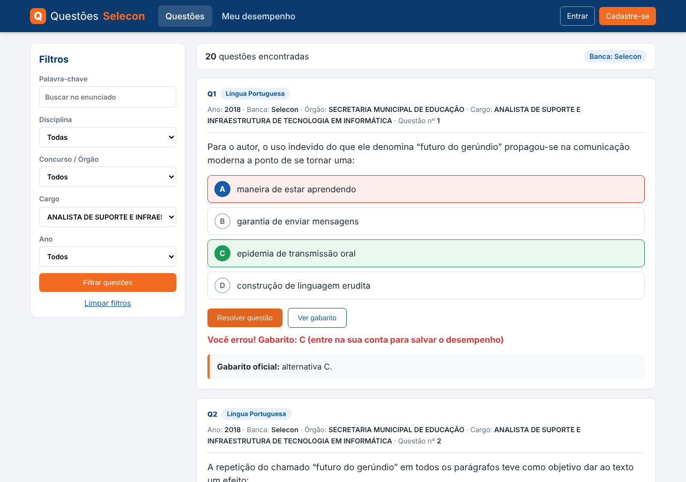

# Questões Selecon

Banco de questões de concursos da banca **Selecon** para estudo, em **PHP 8 + MySQL/MariaDB**, com visual e fluxo
inspirados nos bancos de questões populares: filtros laterais, resolução com correção imediata, gabarito, estatísticas
de acerto e painel administrativo com **importador de PDFs** (provas e gabaritos).

## Funcionalidades

**Para quem estuda**
- Filtros por disciplina, concurso/órgão, cargo, ano, palavra-chave (sem distinção de acentos) e situação
  (não resolvidas, resolvidas, que acertei, que errei).
- Cartão de questão com alternativas clicáveis, "riscar" alternativa (✂), botão **Resolver** com correção na hora,
  **Ver gabarito**, texto de apoio e % de acerto geral da questão.
- Questões anuladas sinalizadas.
- Cadastro e login; página **Meu desempenho** com acertos por disciplina e atividade dos últimos 14 dias.

**Para o administrador** (o primeiro usuário cadastrado vira administrador)
- Importação de provas e gabaritos em PDF com **pré-visualização** antes de gravar.
- PDFs com vários cargos são separados automaticamente; o gabarito é associado pelo código do cargo ou pelo nome.
- Leitura de PDFs em duas colunas, com **OCR** (Tesseract) para páginas escaneadas.
- Tela de **revisão** para corrigir enunciado, alternativas, gabarito, comentário e marcar questões anuladas.

## Tecnologias

PHP ≥ 8.0 (PDO MySQL, mbstring, dom) · MySQL ≥ 5.7 / MariaDB ≥ 10.3 (InnoDB, `utf8mb4`) · HTML/CSS/JS puro, sem frameworks ·
`poppler-utils` (`pdftotext`) e, opcionalmente, `tesseract-ocr` + `tesseract-ocr-por` para importar PDFs.

## Estrutura

    public/        raiz web: páginas, API (api_responder.php), assets/ e admin/
    src/           bootstrap.php (config, PDO, sessão, layout), Parser.php (PDF → questões), Importer.php (gravação)
    tools/         import.php (importação por linha de comando), import_all.sh
    db/            schema.sql (esquema) e dados.sql(.gz) (questões já importadas)
    data/          gabaritos digitados à mão (.txt) para PDFs escaneados
    storage/tmp/   arquivos temporários da importação (precisa de escrita)
    config.sample.php   modelo de configuração

## Instalação

### 1. Banco de dados
Crie o banco e importe o esquema e, se quiser, os dados:

    mysql -u USUARIO -p -e "CREATE DATABASE bancoselecon CHARACTER SET utf8mb4 COLLATE utf8mb4_unicode_ci"
    mysql -u USUARIO -p bancoselecon < db/schema.sql
    mysql -u USUARIO -p bancoselecon < db/dados.sql        # opcional: ~2.500 questões

(No phpMyAdmin: aba **Importar**, primeiro `schema.sql`, depois `dados.sql` ou `dados.sql.gz`.)

### 2. Configuração
Copie `config.sample.php` para `config.php` e preencha host, banco, usuário e senha.
O `config.php` está no `.gitignore` e não deve ser versionado. Alternativamente, use as variáveis de ambiente
`DB_HOST`, `DB_PORT`, `DB_NAME`, `DB_USER` e `DB_PASS`.

### 3a. Desenvolvimento local

    php -d upload_max_filesize=64M -d post_max_size=128M -S localhost:8080 -t public

Acesse `http://localhost:8080` e cadastre-se (o primeiro usuário é o administrador).

### 3b. Hospedagem compartilhada (cPanel)
Use PHP 8.1+ (*Select PHP Version*) com `pdo_mysql`, `mbstring` e `dom`. Deixe `src/`, `storage/` e `config.php`
**fora** da pasta pública e envie o conteúdo de `public/` para o `public_html`:

    /home/USUARIO/
      src/  storage/  config.php
      public_html/   ← conteúdo de public/

Abra `/diagnostico.php` para conferir PHP, extensões, conexão e tabelas e **apague o arquivo em seguida**.

## Importando provas

**Pelo painel:** Administração → *Importar PDFs* → envie prova(s) e gabarito(s) → confira a pré-visualização → *Gravar*.

**Pela linha de comando:**

    php tools/import.php --prova=prova.pdf --gabarito=gabarito.pdf --dry     # só analisa
    php tools/import.php --prova=prova.pdf --gabarito=gabarito.pdf           # grava
    # PDF escaneado sem cabeçalho legível:
    php tools/import.php --prova=prova.pdf --gabarito=gab.txt --orgao="ÓRGÃO" --edital="Nº 001/2024" --cargo="CARGO" --ano=2024

- Gabaritos que são imagem e cujo OCR falha podem ser digitados em `.txt` (exemplos em `data/`):
  uma linha `401 - NOME DO CARGO` seguida de `01: A   02: B ...` (use `X` para questão anulada).
- Reimportar a mesma prova atualiza as questões, sem duplicar.
- Questões de leitura incerta ou sem gabarito ficam marcadas e aparecem em *Administração → Questões para revisar*.

## Limitações conhecidas
- Figuras e tabelas dentro das questões não são importadas (apenas texto).
- PDFs escaneados passam por OCR e podem perder questões; o relatório da importação lista os números não detectados.
- Hospedagens compartilhadas em geral não têm `pdftotext`: importe os PDFs em outro ambiente e envie um novo `dados.sql`.

## Aviso sobre o conteúdo
As provas e gabaritos pertencem à banca organizadora e aos órgãos dos concursos. O projeto é voltado a estudo pessoal;
verifique as condições de uso antes de publicar o banco de questões na internet. Os gabaritos devem ser sempre conferidos
com os documentos oficiais.

## Licença
Defina a licença do projeto antes de publicar (por exemplo, MIT para o código). Sem uma licença, o código fica com todos os direitos reservados.
